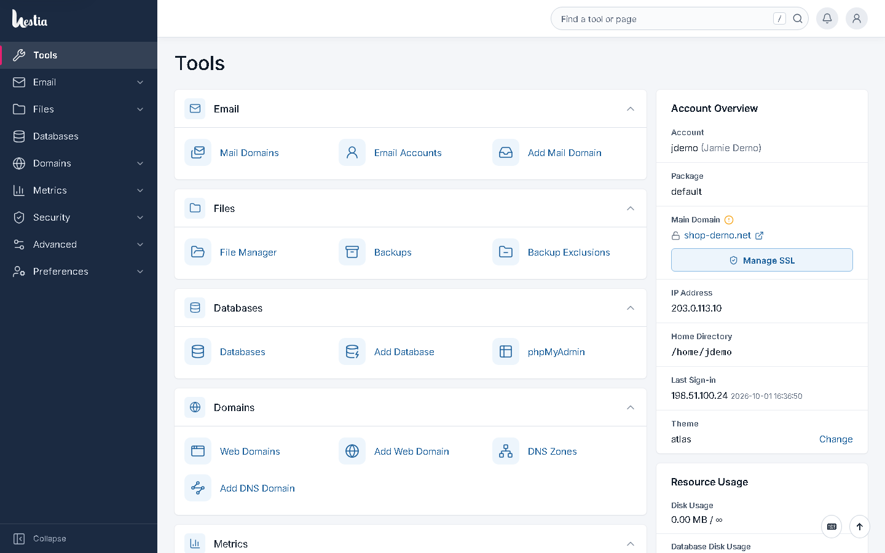
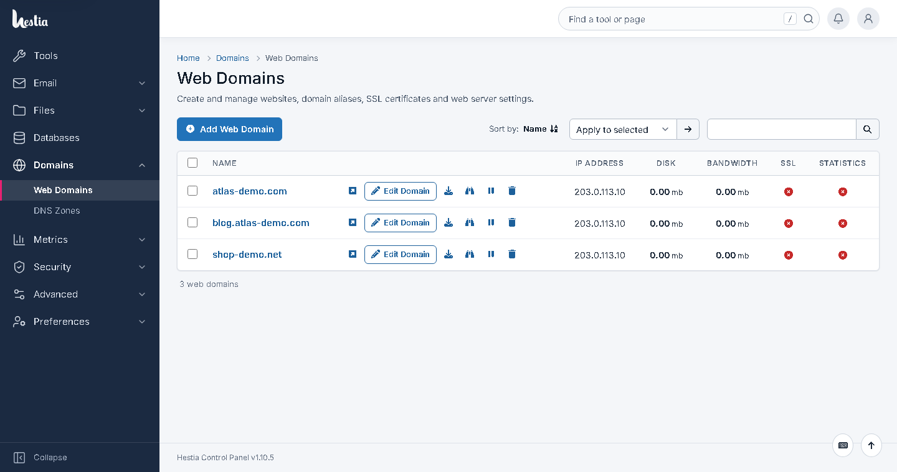
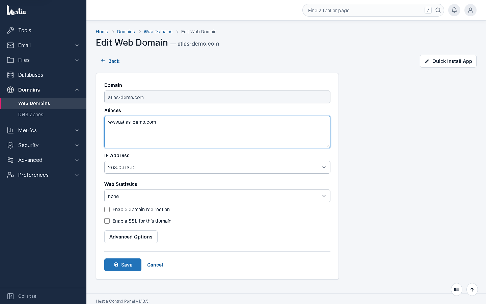
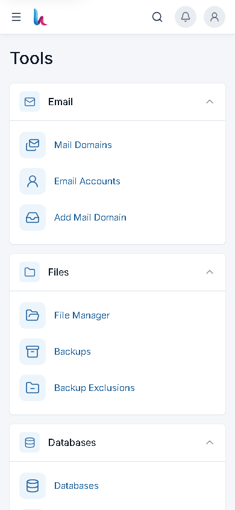
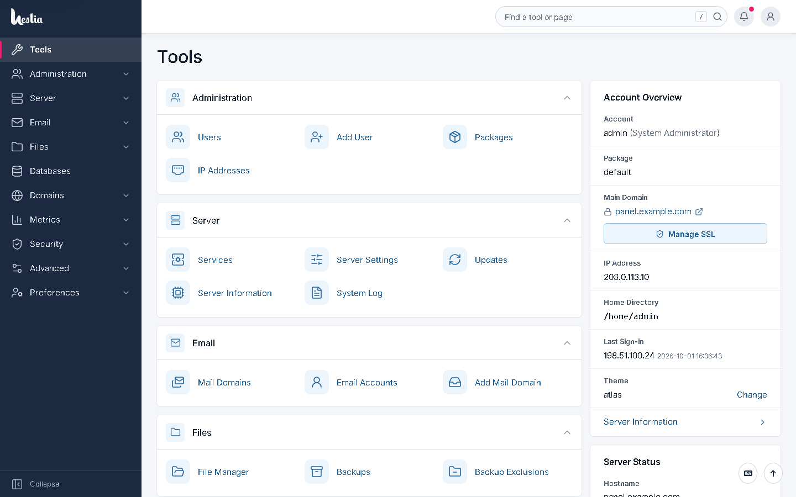
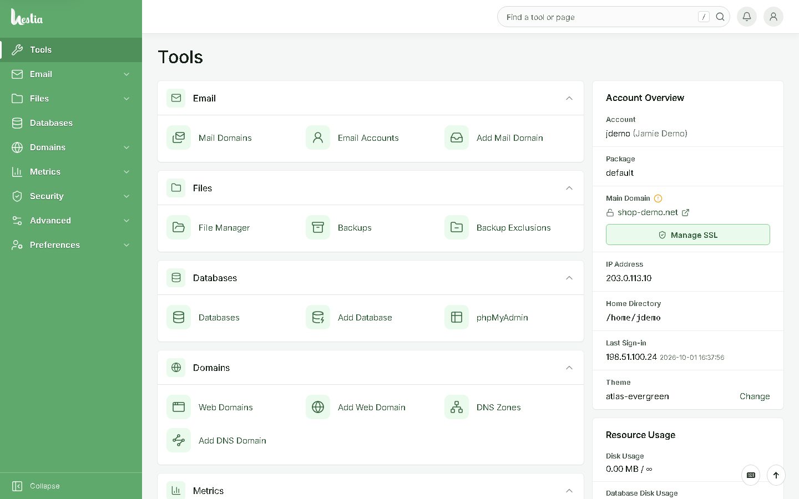
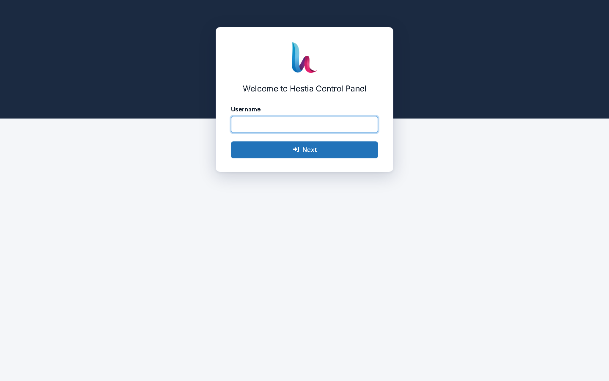
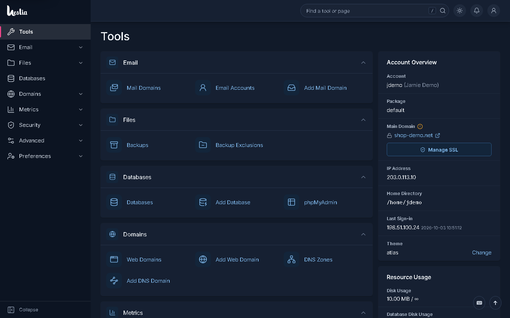
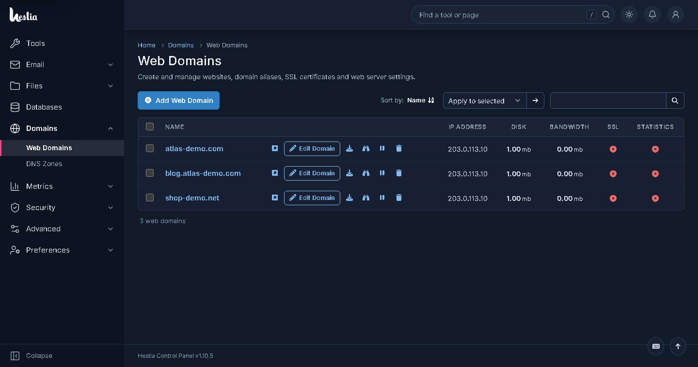

# Hestia Atlas

An alternative interface theme for [HestiaCP](https://hestiacp.com). Hestia Atlas reorganises
the control panel around a left navigation column, a **Tools** home page with grouped tools,
an account and usage overview, clean list pages and focused forms — while every action still
runs through Hestia's own backend.



> **Independent project — inspired by, not affiliated with, cPanel.** The page layout of Hestia
> Atlas is inspired by the general organisation of the cPanel® Jupiter interface so that its
> users feel at home. Hestia Atlas is not affiliated with, endorsed by or sponsored by
> cPanel, L.L.C. or WebPros International GmbH; cPanel® and Jupiter are trademarks of their
> respective owners and are mentioned only to describe that inspiration. No cPanel code, CSS,
> JavaScript, markup, logos, icons, fonts, images or colour values are used: the design
> system is original ([docs/design-system.md](docs/design-system.md)), icons are
> [Lucide](https://lucide.dev) (ISC), the typeface is [Inter](https://rsms.me/inter/)
> (OFL 1.1), and the branding is Hestia's.

## Features

* **Application shell** — navigation column with grouped sections (Email, Files, Databases,
  Domains, Metrics, Security, Advanced, Preferences; Administration and Server for
  administrators), collapsible to an icon rail and off-canvas on tablets and phones; header with
  *Find a tool or page* (`/`), notifications and an account menu; breadcrumbs and page headings.
* **Tools page** (`/atlas/`) — collapsible tool sections; *Account Overview* (account, package,
  main domain with SSL state, IP, home directory, last sign-in, theme); *Resource Usage* with
  meters; *Server Status* (host, OS, Hestia version, load, uptime, service health) for
  administrators. All values come from Hestia (`v-list-user`, `v-list-web-domains`,
  `v-list-user-auth-log`, `v-list-sys-info`, `v-list-sys-services`).
* **Lists** — toolbar with a primary *Add …* button, sort, bulk actions and search; tables with a
  tinted header, always-visible row actions (labelled primary action, red hover for destructive
  actions); labelled cards on small screens.
* **Forms** — card layout, consistent inputs and focus rings, Hestia's own Save button moved to an
  action bar next to *Cancel* (sticky on phones), callout messages, restyled confirmation dialogs.
* **Login** — branded card for login, 2FA and password reset.
* **Colour schemes** — default (Hestia blue) and **Evergreen** (green navigation `#60a96d`).
* **Light and dark mode** — a sun/moon toggle before the notifications bell; follows the
  system preference until you choose, remembered per browser, applied before first paint.
* **Safe by construction** — no Hestia file is patched; CSRF, authentication, permissions,
  translations, validation, bulk actions, dialogs, shortcuts and the API are Hestia's own.

| Web Domains | Edit form | Mobile |
| --- | --- | --- |
|  |  |  |

| Administrator Tools page | Evergreen scheme | Login |
| --- | --- | --- |
|  |  |  |

| Dark mode — Tools | Dark mode — Web Domains |
| --- | --- |
|  |  |

Screenshots of every page — desktop and mobile, administrator and user — are in
[`screenshots/current`](screenshots/current) (default scheme),
[`screenshots/evergreen`](screenshots/evergreen), [`screenshots/lite`](screenshots/lite),
[`screenshots/lite-evergreen`](screenshots/lite-evergreen), [`screenshots/dark`](screenshots/dark), with stock Hestia in
[`screenshots/baseline`](screenshots/baseline).

## Two editions

| | **Hestia Atlas** | **[Hestia Atlas Lite](lite/)** (CSS-only) |
| --- | --- | --- |
| Installed | stylesheets, a PHP loader + library outside the web root, JS, assets, update hook | **one stylesheet per colour scheme** in Hestia's custom theme folder |
| Tools page, grouped navigation with every section, breadcrumbs, header search | ✔ | — |
| Restyled header, navigation, lists, forms, dialogs, login | ✔ | ✔ (built from Hestia's own header and menu) |
| Colour schemes | `atlas`, `atlas-evergreen` | `atlas-lite`, `atlas-lite-evergreen` |
| For | the complete experience | administrators who do not allow extra PHP/JS on the panel |

Both editions can be installed side by side; every user can pick a theme in *Account Settings*.

## Compatibility

| HestiaCP | Status |
| --- | --- |
| 1.10.5 (Debian 12) | developed and tested |
| other 1.10.x | expected to work; installer and update hook verify structure first |
| 1.9 and older, 2.x | not supported — the installer refuses unless `--force` |

Browsers: current Chrome, Edge, Firefox and Safari (`browserslist` *defaults*).

## Installation

On the Hestia server, as root:

```bash
git clone https://github.com/loayai/hestia-atlas.git /opt/hestia-atlas
cd /opt/hestia-atlas
./install.sh                       # or: ./install.sh --scheme evergreen
```

The installer detects HestiaCP and its version, runs structural compatibility checks, copies
the release to `/usr/local/hestia-atlas`, installs the theme files (backing up any file it would
replace), adds a marked block to `/etc/hestiacp/hooks/post_install.sh` (existing logic
preserved), selects the theme (remembering the previous one), verifies every file against the
release manifest and prints every change.

Options: `--dry-run`, `--no-activate`, `--force`, `--scheme default|evergreen`,
`--landing tools|hestia` (page after login). Re-running it is safe and keeps the selected scheme.

## Uninstall

```bash
cd /opt/hestia-atlas && ./uninstall.sh      # add --dry-run to preview
```

Restores the previous theme, clears per-user Atlas selections, removes exactly the files the
installer recorded, restores backed-up files and removes the hook block (or the hook file, if
the installer created it).

## Updating

```bash
cd /opt/hestia-atlas && ./update.sh         # git pull --ff-only, then install.sh --no-activate
```

**Hestia updates** need no action: after every Hestia package upgrade the post-install hook runs
`hestia-atlas repair`, which re-checks compatibility, restores missing theme files, or — if
Hestia's templates changed incompatibly — switches back to the previous theme and notifies the
administrator instead of patching anything. See [docs/updates.md](docs/updates.md).

```bash
hestia-atlas status | check | repair | enable [default|evergreen] | disable
```

## Development

[docs/development.md](docs/development.md) (build, dev-server workflow, Playwright suites),
[docs/architecture.md](docs/architecture.md) (how the theme plugs into Hestia),
[docs/design-system.md](docs/design-system.md) (tokens, provenance, audit),
[docs/design-reference.md](docs/design-reference.md) (layout patterns).

```bash
npm ci && npm run build      # → dist/ and lite/
npm test                     # Playwright workflows against your dev server
```

## Known limitations

* Hestia pages keep their own fields and order; the theme restyles and reorganises them but does
  not merge or split Hestia forms.
* Hestia lists are not paginated server-side; sorting, bulk actions and search are Hestia's.
* The File Manager, phpMyAdmin, webmail and the web terminal are separate applications and keep
  their own look.
* Strings introduced by the theme are English unless Hestia's catalogue already contains them.
* Evergreen's navigation uses white labels on `#60a96d` (2.8:1); labels are semibold to compensate,
  but users who need higher contrast should use the default scheme.

## Licence

GPL-3.0-or-later, the same licence as HestiaCP — see [LICENSE](LICENSE). Bundled assets: Lucide
icons (ISC) and Inter (SIL OFL 1.1); notices are installed with the assets
(`/atlas/assets/LICENSES.txt`).
