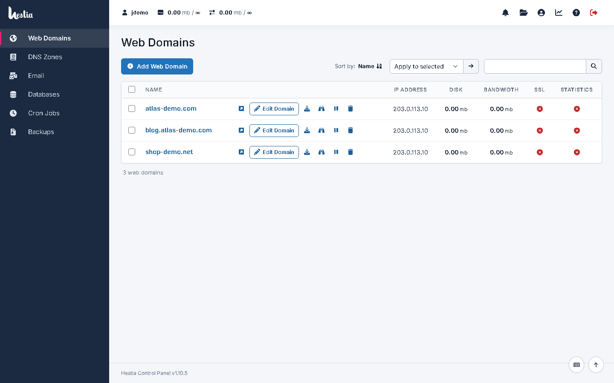
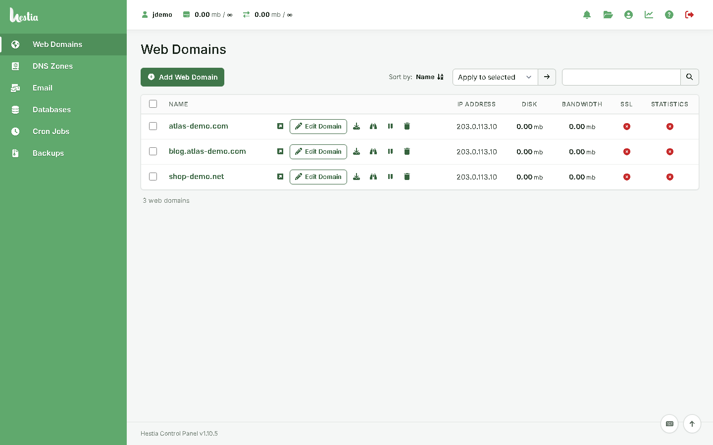

# Hestia Atlas Lite (CSS-only)

**Stylesheets only** — the Hestia Atlas look for administrators who do not want to add any PHP
or JavaScript to their control panel.

It uses only Hestia's built-in custom theme mechanism: Hestia loads
`web/css/themes/custom/<name>.css` after its own stylesheet when that theme is selected.
Nothing else is installed: no PHP, no JavaScript, no hooks, no changes to Hestia files. A
stylesheet cannot run code on the server or in the browser.

| Theme | File | Colours |
| --- | --- | --- |
| `atlas-lite` | `atlas-lite.css` | default (Hestia blue) |
| `atlas-lite-evergreen` | `atlas-lite-evergreen.css` | Evergreen (green navigation `#60a96d`) |





## What you get

* Hestia's header turned into a clean white top bar (account usage, notifications, file manager,
  server settings, profile, statistics, help, log out)
* Hestia's main menu turned into a left navigation column on desktop and a scrollable section bar
  on tablets and phones (descriptive English labels; other languages keep Hestia's translations)
* page headings above the toolbar; restyled toolbars, tables, forms, buttons, alerts, dialogs and
  login — the same design tokens and components as the full theme
* Inter (latin) embedded in each file; other scripts use system fonts

### Compared with the full theme

| | Hestia Atlas | Lite |
| --- | --- | --- |
| Files installed | stylesheets + PHP loader/library + JS + assets + hook | **one stylesheet per scheme** |
| Tools home page, Account Overview, Resource Usage | ✔ | — (Hestia's home pages) |
| Navigation with every section (Security, Metrics, Server …) | ✔ | Hestia's main menu (Users, Web, DNS, Mail, DB, Cron, Backups) |
| Breadcrumbs, page descriptions, header tool search | ✔ | — |
| Save button moved under the form | ✔ | stays in the toolbar |
| Restyled lists, forms, buttons, dialogs, login | ✔ | ✔ |

Both editions can be installed at the same time; each user (or the system) selects one theme.

## Install

Manual — nothing to review but CSS:

```bash
cp atlas-lite.css atlas-lite-evergreen.css /usr/local/hestia/web/css/themes/custom/
```

Then select **atlas-lite** or **atlas-lite-evergreen** in *Server Settings → Basic Options →
Theme* (system-wide) or in *Account Settings → Theme* (per user).

Or with the helper script (verifies checksums, copies the files, optionally activates one):

```bash
sudo ./install.sh --activate                     # default colours
sudo ./install.sh --activate --scheme evergreen  # green
```

## Uninstall

```bash
sudo ./uninstall.sh
```

or select another theme and delete the files.

## Updates

Hestia upgrades do not touch `web/css/themes/custom/`, so the theme survives updates. If a future
Hestia release changes its markup significantly, the effect is cosmetic; select another theme
until new stylesheets are available.

Tested with HestiaCP 1.10.5.

*Independent project; layout inspired by the general organisation of the cPanel® Jupiter
interface. Not affiliated with or endorsed by cPanel, L.L.C. or WebPros. GPL-3.0-or-later.*
